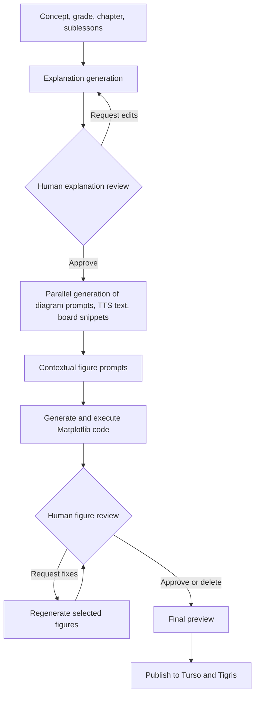

# HITL Explanation Generator

**Human-in-the-loop generation and review of mathematics lessons, teaching diagrams, and narration-ready content.**

HITL Explanation Generator is an internal lesson-authoring application for Pre-O, O-Level, and A-Level mathematics. It uses an LLM-powered [LangGraph](https://github.com/langchain-ai/langgraph) workflow with two human approval gates: first for the explanation, then for the generated figures. Editors can request revisions, remove unwanted diagrams, and publish approved materials to cloud storage.

> **Status:** Internal/prototype content-authoring tool. It is not a standalone student-facing tutor. End-to-end execution requires external model APIs, databases, object storage, and an E2B sandbox template.

## Features

- **Structured explanations:** Generates a motivating context, step-by-step concept explanation, and conclusion.
- **Human review:** Pauses for feedback, regenerates explanations or selected diagrams, and resumes from persisted state.
- **Multiformat lesson output:** Prepares diagram prompts, TTS-friendly narration text, and concise on-screen/whiteboard snippets in parallel.
- **Mathematical visualizations:** Generates Matplotlib code with Gemini and executes it in an isolated E2B sandbox to produce PNG figures.
- **Figure-level controls:** Request improvements to individual figures or delete unwanted ones.
- **Streaming progress:** Sends LangGraph node updates and review interrupts through Server-Sent Events (SSE).
- **Persistent review sessions:** Uses PostgreSQL-backed LangGraph checkpointing.
- **Publishing:** Stores approved lesson records in Turso/libSQL and diagrams in Tigris/S3-compatible storage.
- **Browser-based editor:** Plain HTML, CSS, and JavaScript; no frontend bundler required.

**Note:** This repository prepares text for downstream text-to-speech; it does *not* synthesize speech audio itself.

## Architecture



The `explanation_reviewer` and `fig_reviewer` LangGraph nodes call `interrupt()` to request feedback. The `/hitl/resume_agent_hitl` endpoint resumes the relevant thread with a `Command(resume=...)`. Publishing is a separate action after graph execution finishes.

### Technology stack

| Component | Implementation |
| --- | --- |
| Workflow orchestration | LangGraph |
| Backend and streaming | FastAPI, Uvicorn, `sse-starlette` |
| Structured explanation model | OpenAI Responses API (`gpt-5-chat-latest`) |
| Diagram prompts, TTS text, board snippets | Gemini (`gemini-2.5-flash`) |
| Matplotlib code and figure revisions | Gemini (`gemini-3.1-pro-preview`) |
| Sandboxed code execution | E2B Code Interpreter (`diag-gen` template) |
| Workflow checkpoints | PostgreSQL via `AsyncPostgresSaver` |
| Published lesson metadata | Turso/libSQL |
| Diagram files | Tigris via S3-compatible `boto3` |
| Frontend | HTML, CSS, vanilla JavaScript |

Model names are hardcoded in the current implementation; access to those exact models is required and identifiers may need updating.

## Project structure

```text
HITL-Explanation/
├── Frontend/
│   ├── main1.html                  # Authoring and review UI
│   ├── scripts/main1.js            # SSE, API, and UI logic
│   └── static/style1.css           # Styles
├── app/
│   ├── main.py                     # FastAPI application
│   ├── api/
│   │   ├── hitl/                   # Start/resume workflow endpoints
│   │   ├── crud/                   # Preview, publish, delete diagrams
│   │   └── temp/                   # Auxiliary prompt upload endpoint
│   ├── core/langgraph_/
│   │   ├── Workflow/workflow.py     # State graph and decision paths
│   │   ├── agents/                 # Generators, reviewers, controllers
│   │   ├── schema/                 # Graph state and structured responses
│   │   └── utils/                  # Gemini calls and sandbox execution
│   ├── database/                   # Turso client
│   ├── llm/
│   │   ├── clients/                # OpenAI/Gemini clients
│   │   └── prompts/                # Versioned agent prompt YAML files
│   ├── schema/                     # FastAPI request models
│   └── utils/                      # Persistence, image and upload helpers
├── Dockerfile
├── requirements.txt
└── .env.example
```

During generation, diagram files are saved locally under `app/Storage/<concept_id>/fig_<index>.png` (gitignored).

## Getting started

### Prerequisites

- Python **3.11** (the version used by the Docker image).
- OpenAI and Google Gemini API credentials with access to the models used above.
- An E2B API key and a custom sandbox template named **`diag-gen`**, capable of running Python/Matplotlib and writing PNGs.
- A PostgreSQL database for LangGraph checkpoints (`SUPABASE_DB_URL`).
- A Turso/libSQL database with the required lesson tables already provisioned.
- Tigris/S3-compatible credentials and an existing **`explanation-dev`** bucket.

**Not included:** Database migrations/table DDL, the `diag-gen` E2B template definition, or automated infrastructure provisioning. The complete pipeline cannot run without these resources.

### 1. Clone and install dependencies

```bash
git clone https://github.com/Humzafazal72/HITL-Explanation.git
cd HITL-Explanation
python3.11 -m venv .venv
source .venv/bin/activate
pip install -r requirements.txt
```

### 2. Configure environment variables

Create `.env` in the repository **root**:

```dotenv
OPENAI_API_KEY=
GOOGLE_API_KEY=
E2B_API_KEY=

SUPABASE_DB_URL=
TURSO_EXPLANATION_DB_URL=
TURSO_EXPLANATION_DB_TOKEN=

TIGRIS_STORAGE_ENDPOINT=
TIGRIS_STORAGE_ACCESS_KEY_ID=
TIGRIS_STORAGE_SECRET_ACCESS_KEY=
```

The example file in the repository also lists other variables not required by the core authoring flow. Never commit `.env` or reuse any credentials that have been published.

`SUPABASE_DB_URL` must be a PostgreSQL connection string compatible with the LangGraph checkpointer. The application initializes the checkpoint tables, but **does not create the Turso lesson schema**. Code in `app/utils/utils.py` expects the following Turso tables: `Lessons`, `Conclusions`, `Contexts`, `sublessons`, `explanation_steps`, `tts_steps`, `context_snippets`, `conclusion_snippets`, and `step_snippets`.

The publish operation uploads diagrams to the `explanation-dev` bucket using S3 keys of the form `Diagrams/<concept_id>/<filename>`.

### 3. Start the backend

Run Uvicorn **from inside `app/`** because imports and prompt YAML paths are relative to this directory:

```bash
cd app
uvicorn main:app --reload --host 127.0.0.1 --port 8000
```

- Health check: http://127.0.0.1:8000/health
- Interactive API docs: http://127.0.0.1:8000/docs

### 4. Start the frontend

From the repository root, in a second terminal:

```bash
python3 -m http.server 5500 --directory Frontend
```

Open **http://127.0.0.1:5500/main1.html**. The frontend uses `http://127.0.0.1:8000` as `API_BASE_URL`, configured at the beginning of `Frontend/scripts/main1.js`. Update it if the backend is hosted elsewhere.

### Docker (backend only)

```bash
docker build -t hitl-explanation .
docker run --rm -p 8000:8000 --env-file .env hitl-explanation
```

Use `KEY=value` lines without spaces around `=` in `.env` for Docker. The image starts Uvicorn from `/app/app`. `Frontend/` is excluded by `.dockerignore`, so host it separately. Local figure files inside a container are ephemeral unless the `Storage/` directory is mounted or the figures are published.

## API reference

| Method | Endpoint | Purpose |
| --- | --- | --- |
| `GET` | `/health` | Health check |
| `POST` | `/hitl/start_agent_hitl` | Start generation; returns SSE stream |
| `POST` | `/hitl/resume_agent_hitl` | Apply review decision and resume SSE stream |
| `GET` | `/crud/get_data/?concept_id=...&diagrams=true` | Preview explanation and optionally base64-encoded PNGs |
| `POST` | `/crud/add_to_cloud/?concept_id=...` | Upload figures and save lesson to Turso |
| `DELETE` | `/crud/delete_figures?concept_id=...` | Remove local figure directory |
| `POST` | `/api/upload-prompt` | Auxiliary text prompt upload utility |

The start and resume endpoints return **`text/event-stream`**, not a normal JSON response. Named events correspond to LangGraph nodes. An `__interrupt__` event requests human input; its SSE `id` is the concept/thread ID to use in subsequent requests.

### Start a lesson

```bash
curl -N -X POST http://127.0.0.1:8000/hitl/start_agent_hitl \
  -H 'Content-Type: application/json' \
  -H 'Accept: text/event-stream' \
  -d '{
    "concept": "Pythagorean Theorem",
    "lesson_num": 1,
    "chapter_name": "GEOMETRY AND SHAPE I",
    "chapter_num": 6,
    "grade": "O-1",
    "sublessons": ["Right-angled triangles", "Finding the hypotenuse"]
  }'
```

Accepted grade values: `Pre-O`, `O-1`, `O-2`, `A-1`, `A-2`. The current frontend dropdown defines chapters for Pre-O, O-1, and O-2.

### Review an explanation

When the stream interrupts for explanation review, retrieve the draft using the SSE `id`:

```bash
curl 'http://127.0.0.1:8000/crud/get_data/?concept_id=YOUR_CONCEPT_ID&diagrams=false'
```

Approve and resume:

```bash
curl -N -X POST http://127.0.0.1:8000/hitl/resume_agent_hitl \
  -H 'Content-Type: application/json' \
  -d '{
    "concept_id": "YOUR_CONCEPT_ID",
    "type": "explanation",
    "decision": {"change": false, "comment": ""}
  }'
```

To request a revised explanation, send `"change": true` with a nonempty `comment` describing the edits.

### Review generated figures

At the figure review interrupt, you can approve the images or suggest per-image changes. Example request body for `POST /hitl/resume_agent_hitl`:

```json
{
  "concept_id": "YOUR_CONCEPT_ID",
  "type": "figure",
  "decision": {
    "change": true,
    "change_descriptions": {
      "fig_0": "Make the right-angle marker clearer.",
      "fig_1": "delete"
    }
  }
}
```

To approve without corrections, set `change` to `false` and `change_descriptions` to `{}`. The application shows the final content and offers a separate **Upload to Cloud** action.

## Persistence and publishing

**While editing:** A generated `concept_id` is used as the LangGraph thread ID, with PostgreSQL checkpoint storage for review/resume operations. Figures are saved under `Storage/<concept_id>/` relative to the backend working directory.

**When publishing:** `/crud/add_to_cloud/` uploads local diagrams to Tigris, stores explanation context, steps, conclusion, sublessons, TTS text, and snippets in Turso, then deletes the local image directory. This operation is **not** automatically invoked by the graph.

## Known limitations and security considerations

- **No authentication:** The existing HTTP endpoints do not enforce user authentication. Protect the backend and its publishing/upload endpoints before external deployment.
- **Permissive CORS:** The FastAPI application currently allows all origins, methods, and headers; restrict these for production.
- **External setup required:** The repository contains neither Turso DDL/migrations nor the custom E2B `diag-gen` template configuration.
- **Secrets hygiene:** Review committed example configuration files and Git history for accidentally exposed credentials; revoke and rotate exposed keys.
- **Model availability:** The named OpenAI/Gemini models and preview identifiers are specified in Python and may need updating if unavailable.
- **No automated tests:** There is no committed end-to-end test suite or CI pipeline in the current repository.
- **Review AI output:** Mathematical explanations and generated figures should be validated by an editor before publication.

## Contributing

Issues and pull requests are welcome. Include the affected LangGraph nodes or API routes and describe how the review/resume flow was verified.

## License

This repository currently has no license file. Unless a license is added, do not assume permission to reuse, modify, or redistribute its code beyond what applicable law permits.
